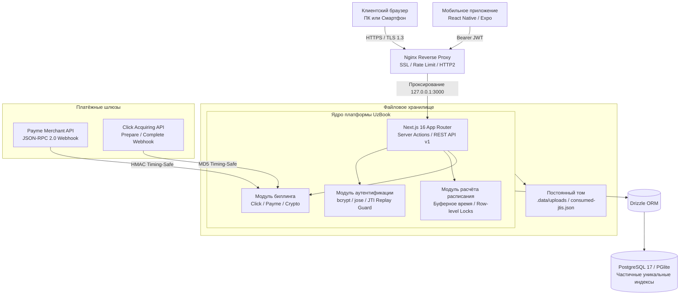

<div align="center">

# UzBook

**SaaS-платформа онлайн-записи и автоматизации сферы услуг в Узбекистане**

Официальный сайт платформы: [uzbook.online](https://uzbook.online)

[](https://uzbook.online)
[](https://nextjs.org/)
[](https://react.dev/)
[](https://www.typescriptlang.org/)
[](https://tailwindcss.com/)
[](https://www.postgresql.org/)
[](https://orm.drizzle.team/)
[](./FINAL_AUDIT_RU.md)

<p align="center">
  <a href="#описание-платформы">Описание</a> •
  <a href="#ключевые-возможности">Возможности</a> •
  <a href="#архитектура-системы">Архитектура</a> •
  <a href="#интерфейс-и-пользовательский-опыт">Интерфейс</a> •
  <a href="#быстрый-старт">Быстрый старт</a> •
  <a href="#rest-api-v1-и-мобильное-приложение">REST API</a> •
  <a href="#биллинг-и-эквайринг">Биллинг</a> •
  <a href="#безопасность">Безопасность</a> •
  <a href="#деплой-в-production">Деплой</a>
</p>

---

</div>

## Описание платформы

**UzBook** ([uzbook.online](https://uzbook.online)) — это облачное программное обеспечение (SaaS) для малого и среднего сервисного бизнеса в Республике Узбекистан: салонов красоты, барбершопов, стоматологических клиник, спа-салонов, массажных кабинетов и индивидуальных мастеров.

Сервис решает ключевые операционные задачи:
* Предоставляет каждому бизнесу персональную онлайн-витрину на поддомене или прямом адресе вида `uzbook.online/[slug]`.
* Обеспечивает сквозную запись клиентов без необходимости принудительной регистрации и авторизации.
* Автоматизирует составление расписания мастеров с учётом буферного времени, графика смен и индивидуальных услуг.
* Включает партнёрскую сеть (провайдеров) с автоматическим начислением комиссий до 60% от оплат подключённых салонов.
* Интегрирует национальные платёжные системы Республики Узбекистан (Payme, Click) для приёма онлайн-оплат в национальной валюте UZS.

```text
+-----------------------------------------------------------------------------------------+
|                                    ЭКОСИСТЕМА UZBOOK.ONLINE                             |
+-------------------------+--------------------------+------------------------------------+
|    КЛИЕНТСКИЙ СЕРВИС    |     КАБИНЕТ САЛОНА       |          СЕТЬ ПАРТНЁРОВ            |
|                         |                          |                                    |
| - Запись без пароля     | - Таймлайн расписания    | - Провайдеры привлечения клиентов  |
| - Персональный лендинг  | - Каталог услуг и цен    | - Доля 60% от тарифов подписок     |
| - Управление по токену  | - Учёт мастеров и смен   | - Индивидуальные цены и лимиты     |
| - Расчёт свободных окон | - База клиентов (CRM)    | - Прямые выплаты на Uzcard / Humo  |
+-------------------------+--------------------------+------------------------------------+
```

---

## Ключевые возможности

### 1. Клиентский интерфейс (Self-Service)
* **Быстрое бронирование:** выбор услуги, выбор мастера, выбор слота в календаре, подтверждение контактов.
* **Автономное управление бронью (`/b/[token]`):** ссылка в SMS или мессенджере позволяет клиенту в один клик отменить или перенести визит без звонка администратору, с соблюдением минимального срока отмены (`cancellationHours`).
* **Мобильная вёрстка:** адаптивный веб-интерфейс, оптимизированный для работы на мобильных устройствах под управлением iOS и Android.

### 2. Панель управления салона (`/dashboard`)
* **Сетка таймлайна дня:** интерактивное отображение бронирований всех мастеров в реальном времени с поддержкой статусов (`CONFIRMED`, `COMPLETED`, `NO_SHOW`, `CANCELLED`).
* **Быстрые действия:** моментальная блокировка времени мастера (перерывы, личные дела) и закрытие рабочего дня.
* **Каталог услуг и сотрудники:** настройка стоимости, длительности, буферных интервалов до и после приёма, привязка мастеров к категориям услуг.
* **База клиентов (CRM):** карточки клиентов, статистика посещаемости, сегментация (VIP, постоянные, новые, спящие), заметки и выгрузка отчётов в Excel/CSV.
* **Конструктор страницы бизнеса (`/dashboard/profile`):** загрузка логотипа, обложки, портфолио в галерею «до/после», выбор фирменных цветов и генерация готового QR-кода для печати на стойку ресепшена.

### 3. Кабинет провайдера (`/provider`)
* **Партнёрский онбординг:** регистрация новых салонов с выдачей бесплатного промо-периода от 14 до 30 дней.
* **Индивидуальная тарификация:** возможность задавать персональную цену подписки (`customPriceUzs`) и увеличенные лимиты персонала (`customStaffLimit`) и клиентов (`customClientLimit`).
* **Управление клиентами:** просмотр подключённых точек, контроль поступления платежей, сброс паролей клиентов и отправка ссылок на продление тарифа.

### 4. Панель главного администратора (`/admin`)
* **Аналитический обзор:** мониторинг ключевых показателей (MRR, количество активных салонов, динамика записей).
* **Модерация и контроль:** управление статусами предприятий (`ACTIVE`, `SUSPENDED`, `DRAFT`), продление пробных периодов, одобрение заявок на платёжные тарифы.
* **Аудит безопасности:** детальный журнал всех системных действий с фиксацией IP, идентификатора пользователя и параметров операции.

---

## Архитектура системы



---

## Интерфейс и пользовательский опыт

### Макет таймлайна в панели управления (`/dashboard`)
```text
+----------------------------------------------------------------------------------------+
|  UZBOOK.ONLINE  |  Салон «Atelier Noir»      [ Дата: 2 ноября 2026 ]   [ + Новая запись] |
+-----------------+----------------------------------------------------------------------+
|  Мастер         | 10:00        11:00        12:00        13:00        14:00        ...   |
+-----------------+----------------------------------------------------------------------+
|  Мадина К.      | [ Стрижка и укладка (CONFIRMED) ]      [ Окрашивание Airtouch ]        |
|  (Стилист)      |   Клиент: Дильноза (+998 90 ...)         Клиент: Севара (+998 97 ...)  |
+-----------------+----------------------------------------------------------------------+
|  Алина С.       |              [ Макияж Nude (CONF) ]    [ ПЕРЕРЫВ / БЛОКИРОВКА ]        |
|  (Визажист)     |                Клиент: Зарина ...        Заблокировано владельцем      |
+-----------------+----------------------------------------------------------------------+
|  Дилшод Р.      | [ Стрижка Fade ]          [ Моделирование бороды ]                     |
|  (Барбер)       |   Клиент: Фаррух ...        Клиент: Джасур ...                         |
+-----------------+----------------------------------------------------------------------+
```

---

## Технологический стек

| Категория | Используемые решения | Назначение |
| :--- | :--- | :--- |
| **Пользовательский интерфейс** | Next.js 16.4 (App Router), React 19.2, Tailwind CSS 4.1 | Серверный и гибридный рендеринг, мгновенные переходы |
| **Компоненты интерфейса** | lucide-react, @dnd-kit/core, @dnd-kit/sortable | Интерактивные списки, drag-and-drop сортировка секций |
| **Серверная логика** | Next.js Server Actions, Node.js Runtime 22.x | Защищённые транзакционные операции без открытых эндпоинтов |
| **База данных** | PostgreSQL 17, @electric-sql/pglite | Реляционная СУБД; PGlite для автономной разработки без внешнего сервера |
| **ORM и миграции** | Drizzle ORM 0.45, drizzle-kit | Типизированная схема БД, транзакции, частичные уникальные индексы |
| **Авторизация и безопасность** | jose, bcryptjs, node:crypto | JWT-токены, хэширование паролей, защита от повторных атак (JTI) |
| **Инфраструктура развёртывания**| Docker, Docker Compose, Nginx | Контейнеризация, ротация воркеров фонового обслуживания |

---

## Быстрый старт

### Системные требования
* Node.js 20.x или 22.x LTS
* npm 10+
* Docker Engine и Docker Compose (для контейнерного запуска)

### Запуск в режиме разработки (с встроенной БД PGlite)

UzBook поддерживает запуск без предварительной установки PostgreSQL — используется встроенный движок PGlite:

```bash
# Клонирование репозитория
git clone https://github.com/u2kdev/uzbook.git
cd uzbook

# Установка зависимостей проекта
npm install

# Применение схемы и миграций к локальной БД (.data/pg)
npm run db:migrate

# Заполнение демонстрационными данными
npm run db:seed

# Запуск локального сервера разработки
npm run dev
```

После запуска приложение доступно в браузере по адресу: `http://localhost:3000`

> [!NOTE]
> Локальная база PGlite предназначена для одного процесса Node.js внутри каталога `./.data/pg`. В производственной среде обязательно подключение полноценного экземпляра PostgreSQL через переменную `DATABASE_URL`.

---

## Тестовые учётные записи

При выполнении команды `npm run db:seed` создаются учётные записи для всех системных ролей:

| Роль | Логин / Телефон / Email | Пароль | Доступный раздел |
| :--- | :--- | :--- | :--- |
| **Администратор** | `admin@uzbook.online` / `admin` | `admin1234` | `/admin` (Управление платформой) |
| **Служба поддержки** | `support@uzbook.online` / `support` | `support1234` | `/admin` (Режим просмотра без изменения тарифов) |
| **Провайдер** | `provider@uzbook.online` / `provider` | `provider1234`| `/provider` (Партнёрская панель, 60% комиссия) |
| **Владелец салона** | `+998901234567` / `owner@uzbook.online` | `owner1234` | `/dashboard` (Салон «Atelier Noir») |
| **Барбершоп** | `+998907654321` / `barber@uzbook.online` | `barber1234` | `/dashboard` (Салон «Barber House») |

> [!IMPORTANT]
> Создание тестовых аккаунтов программно заблокировано при значении `NODE_ENV=production`. Первого администратора боевого стенда создают командой `npm run admin:create`.

---

## REST API v1 и Мобильное приложение

Платформа UzBook предоставляет открытый интерфейс прикладного программирования (REST API v1) с авторизацией по токенам Bearer JWT.

* **Интерактивная спецификация Swagger UI:** [uzbook.online/api/v1/docs](https://uzbook.online/api/v1/docs)
* **Схема OpenAPI 3.1 JSON:** [uzbook.online/api/v1/openapi.json](https://uzbook.online/api/v1/openapi.json)

### Список основных эндпоинтов

```http
POST   /api/v1/auth/login                  Аутентификация (телефон, email или логин)
POST   /api/v1/auth/refresh                Ротация JWT-токенов с проверкой одноразового JTI
GET    /api/v1/auth/me                     Данные профиля авторизованного пользователя

GET    /api/v1/salons/{slug}               Информация о салоне, прайс-листе и мастерах
GET    /api/v1/salons/{slug}/availability  Доступные слоты на указанную дату
POST   /api/v1/bookings                    Создание клиентской записи
GET    /api/v1/bookings/{token}            Получение сведений о записи по токену управления
POST   /api/v1/bookings/{token}/cancel     Отмена записи со стороны клиента
POST   /api/v1/bookings/{token}/reschedule Перенос даты и времени визита клиентом

GET    /api/v1/owner/today                 Расписание и сводка салона на текущий день
GET    /api/v1/owner/bookings              Журнал записей бизнеса с фильтрами
PATCH  /api/v1/owner/bookings/{id}/status  Смена статуса записи владельцем
GET    /api/v1/owner/staff                 Список мастеров салона
GET    /api/v1/owner/services              Список предоставляемых услуг
```

### Мобильный клиент
Исходный код приложения для платформ iOS и Android размещён в каталоге [`mobile/`](./mobile). Приложение разработано на базе React Native / Expo, поддерживает безопасное хранение токенов в `SecureStore` и обработку Deep Link ссылок вида `uzbook://salon/{slug}` и `uzbook://booking/{token}`.

---

## Биллинг и эквайринг

В платформу заложена модель автоматизированного приёма платежей и взаиморасчётов:

* **Прямые продажи:** салон приобретает подписку напрямую на платформе (100% выручки платформе).
* **Партнёрская модель (Provider):** салон закреплён за провайдером, ставка комиссии партнёра фиксируется в договоре (по умолчанию 60%), а сумма отчислений рассчитывается в транзакции и сохраняется в `subscriptions.provider_payout_amount`.

### Поддерживаемые платёжные провайдеры
* **Payme:** соответствие спецификации Merchant API (JSON-RPC 2.0). Реализованы методы: `CheckPerformTransaction`, `CreateTransaction`, `PerformTransaction`, `CancelTransaction`, `CheckTransaction`, `GetStatement`.
* **Click:** протокол Prepare / Complete с проверкой подписи `timingSafeEqual`.
* **Криптоплатежи (Beta):** прямые транзакции USDT (сеть TRC-20) с проверкой уникальности хэша транзакции.
* **Безналичный перевод:** выставление счетов на ручную оплату с модерацией в `/admin/requests`.

---

## Безопасность

Архитектура системы безопасности UzBook прошла независимый аудит и получила оценку **96 из 100** (отчёт в файле [`FINAL_AUDIT_RU.md`](./FINAL_AUDIT_RU.md)):

* **Отпечатки сессий (Session Fingerprint):** HMAC-SHA256 подпись пароля и роли в токене сессии гарантирует немедленное прекращение доступа во всех устройствах при смене пароля.
* **Защита от Replay-атак Refresh-токенов:** использованные токены `jti` сохраняются в защищённую базу `.data/consumed-jtis.json`.
* **Изоляция арендаторов (Multi-Tenancy):** каждый запрос строго ограничен `businessId`, доступ к бронированиям и клиентским данным других салонов исключён на уровне SQL-запросов.
* **Защита персональных данных:** токены управления записями исключены из публичных списков, на страницах бронирований запрещена индексация поисковыми ботами (`robots: noindex, nofollow`).
* **Безопасная обработка файлов:** загружаемые изображения проверяются по реальным сигнатурам (Magic Bytes), сохраняются под именами UUID v4 и отдаются с заголовком изолированного контейнера `sandbox`.
* **Защита от инъекций в формулы Excel:** при выгрузке клиентской базы в CSV спецсимволы экранируются апострофом (`escapeCsvCell`).
* **HTTP-заголовки безопасности:** Strict-Transport-Security (HSTS), Content-Security-Policy (CSP), X-Frame-Options (SAMEORIGIN), X-Content-Type-Options (nosniff).

---

## Деплой в Production

### Развёртывание стека через Docker Compose

```bash
# 1. Создание файла переменных окружения
cp .env.example .env

# В файле .env укажите:
#   APP_URL=https://uzbook.online
#   AUTH_SECRET=<сгенерируйте строкой от 32 символов: openssl rand -base64 32>
#   POSTGRES_PASSWORD=<сложный пароль базы данных>
#   PAYME_MERCHANT_ID=... / PAYME_KEY=...
#   CLICK_SERVICE_ID=... / CLICK_MERCHANT_ID=... / CLICK_SECRET_KEY=...

# 2. Сборка образов и запуск контейнеров
docker compose up -d --build

# 3. Инициализация учётной записи главного администратора
docker compose run --rm --no-deps maintenance \
  node ./node_modules/tsx/dist/cli.mjs scripts/create-admin.ts

# 4. Проверка готовности сервиса
curl -I https://uzbook.online/api/health
```

### Состав контейнеров
* **`app`**: изолированный контейнер Next.js Standalone, автоматически применяющий миграции СУБД при запуске (`RUN_MIGRATIONS_ON_START=true`).
* **`db`**: официальный образ PostgreSQL 17 Alpine с постоянным томом `pg_data`.
* **`maintenance`**: фоновый процесс, выполняющий очистку просроченных платежей и временных файлов.
* **`app_data`**: общий персистентный том `/app/.data` для хранения пользовательских загрузок и черного списка токенов.

Конфигурационный файл Nginx с поддержкой SSL, сжатия и лимитов частоты запросов расположен в [`deploy/nginx.conf`](./deploy/nginx.conf).

---

## Проверка и тестирование

Для контроля качества и регрессионного тестирования проект содержит набор скриптов:

```bash
# Статический анализ TypeScript
npm run typecheck

# Тестирование исправлений безопасности (P0, P1, P2)
node ./node_modules/tsx/dist/cli.mjs scripts/test-new-p1-fixes.ts
node ./node_modules/tsx/dist/cli.mjs scripts/test-new-p2-fixes.ts

# Тестирование жизненного цикла платежей и вебхуков
node ./node_modules/tsx/dist/cli.mjs scripts/test-payments-lifecycle.ts

# Сквозное функциональное тестирование системы (Fullstack E2E)
node ./node_modules/tsx/dist/cli.mjs scripts/test-fullstack-scenarios.ts

# Проверка контрактов REST API v1
node ./node_modules/tsx/dist/cli.mjs scripts/test-api-v1.ts

# Комплексный аудит предрелизной готовности
node ./node_modules/tsx/dist/cli.mjs scripts/release-check.ts
```

---

<div align="center">

Платформа онлайн-записи и автоматизации сферы услуг Республики Узбекистан • [uzbook.online](https://uzbook.online)

</div>
