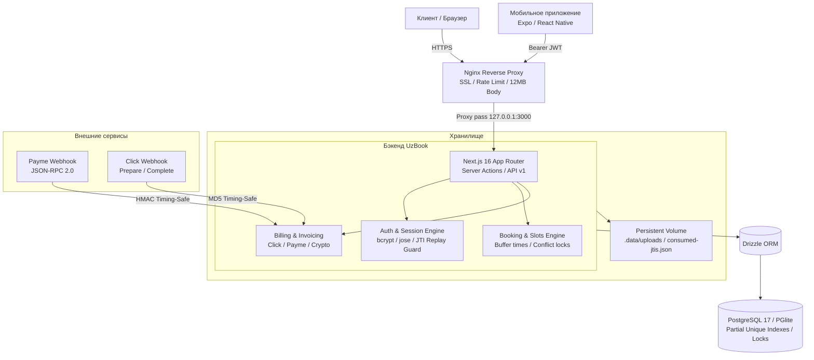

<div align="center">

# UzBook Platform

**Современная SaaS-платформа онлайн-записи и автоматизации сферы услуг в Узбекистане**

[](https://nextjs.org/)
[](https://react.dev/)
[](https://www.typescriptlang.org/)
[](https://tailwindcss.com/)
[](https://www.postgresql.org/)
[](https://orm.drizzle.team/)
[](./FINAL_AUDIT_RU.md)
[](#)

<p align="center">
  <a href="#-ключевые-возможности">Возможности</a> •
  <a href="#-архитектура-системы">Архитектура</a> •
  <a href="#-интерфейс-и-пользовательский-опыт">Интерфейс</a> •
  <a href="#-быстрый-старт">Быстрый старт</a> •
  <a href="#-rest-api-v1-и-мобильное-приложение">REST API</a> •
  <a href="#-биллинг-и-платежи">Биллинг</a> •
  <a href="#-безопасность">Безопасность</a> •
  <a href="#-деплой-в-production">Деплой</a>
</p>

---

</div>

## 📌 О проекте

**UzBook** — это производительное мультитенантное решение для автоматизации записи клиентов в салонах красоты, барбершопах, спа-центрах, медицинских клиниках и частных кабинетах.

Платформа полностью локализована для рынка Узбекистана: расчёты в **UZS**, интеграция с национальными платёжными шлюзами **Payme** и **Click**, учёт часового пояса `Asia/Tashkent` и валидация телефонных номеров формата `+998`.

```text
┌─────────────────────────────────────────────────────────────────────────────────────────┐
│                                       ЭКОСИСТЕМА UZBOOK                                 │
├─────────────────────────┬──────────────────────────┬────────────────────────────────────┤
│   КЛИЕНТСКИЙ ОПЫТ       │     КАБИНЕТ ВЛАДЕЛЬЦА    │       ПАРТНЁРСКАЯ СЕТЬ             │
│                         │                          │                                    │
│ • Запись без логина     │ • Таймлайн дня (Day View)│ • Провайдеры (агенты привлечения)  │
│ • Персональный лендинг  │ • Конструктор страниц    │ • Доля 60% от оплат подписок       │
│ • Управление по токену  │ • CRM клиентов и визитов │ • Индивидуальные тарифы и лимиты   │
│ • Авто-определение слота│ • Буферное время и паузы │ • Выплаты на карты Uzcard / Humo   │
└─────────────────────────┴──────────────────────────┴────────────────────────────────────┘
```

---

## ⚡ Ключевые возможности

### 1. Для клиентов (Self-Service Experience)
* **Запись за 4 шага без пароля:** выбор услуги ➔ выбор мастера ➔ выбор свободного времени ➔ ввод имени и телефона.
* **Автономное управление бронью (`/b/[token]`):** клиент получает прямую ссылку, по которой может проверить статус, перенести время визита или отменить запись в соответствии с правилами салона (`cancellationHours`).
* **Мобильная адаптивность:** интерфейс оптимизирован под сенсорные экраны любых смартфонов.

### 2. Для владельцев бизнеса (Salon Operations)
* **Интерактивный таймлайн дня:** визуальная сетка занятости мастеров с шагом от 5 до 60 минут, отображением статусов (`CONFIRMED`, `COMPLETED`, `NO_SHOW`, `CANCELLED`).
* **Быстрые действия (Quick Actions):** блокировка перерывов, установка внеплановых выходных или больничных для одного или всех мастеров.
* **Каталог услуг и команда:** привязка услуг к конкретным мастерам, индивидуальная длительность, буферы до и после приёма.
* **База клиентов (CRM):** автоматический расчёт визитов, LTV, среднего чека, сегментация (VIP, регулярные, новые, спящие), заметки и безопасный экспорт в Excel/CSV.
* **Конструктор витрины (`/dashboard/profile`):** настройка шрифтовых пар, акцентных цветов, обложки, логотипа, галереи «до/после» и генерация фирменного QR-кода.

### 3. Для провайдеров (Partner / Provider Network)
* **Агентская модель:** партнёры привлекают салоны и получают до **60%** от всех их платежей.
* **Кастомизация тарифов:** установка индивидуальных лимитов мастеров (`customStaffLimit`), клиентов (`customClientLimit`) и персональной абонентской платы (`customPriceUzs`).
* **Кабинет партнёра (`/provider`):** мониторинг активных клиентов, учёт комиссионного дохода, сброс паролей и выставление счетов на оплату.

### 4. Для администраторов платформы (Super Admin)
* **Обзор платформы (`/admin`):** аналитика MRR, распределение тарифов, контроль статусов (`ACTIVE`, `SUSPENDED`, `DRAFT`).
* **Журнал безопасности (`/admin/logs`):** централизованный аудит всех критических действий пользователей.
* **Управление промо-материалами (`/admin/logos`):** загрузка и модерация логотипов брендов доверия в карусели на главной странице.

---

## 🏗 Архитектура системы



---

## 💻 Интерфейс и пользовательский опыт

### Таймлайн дня в кабинете салона (`/dashboard`)
```text
┌────────────────────────────────────────────────────────────────────────────────────────┐
│  UZBOOK  •  Салон «Atelier Noir»      [ Сегодня: 2 ноября 2026 ]   [ + Записать клиента]│
├─────────────────┬──────────────────────────────────────────────────────────────────────┤
│  Мастер         │ 10:00        11:00        12:00        13:00        14:00        ... │
├─────────────────┼──────────────────────────────────────────────────────────────────────┤
│  Мадина К.      │ [ Стрижка и укладка (CONFIRMED) ]      [ Окрашивание Airtouch ]      │
│  (Стилист)      │   Клиент: Дильноза (+998 90 ...)         Клиент: Севара (+998 97 ...)│
├─────────────────┼──────────────────────────────────────────────────────────────────────┤
│  Алина С.       │              [ Макияж Nude (CONF) ]    [ 🔒 ПЕРЕРЫВ НА ОБЕД ]        │
│  (Визажист)     │                Клиент: Зарина ...        Заблокировано владельцем    │
├─────────────────┼──────────────────────────────────────────────────────────────────────┤
│  Дилшод Р.      │ [ Стрижка Fade ]          [ Моделирование бороды ]                   │
│  (Барбер)       │   Клиент: Фаррух ...        Клиент: Джасур ...                       │
└─────────────────┴──────────────────────────────────────────────────────────────────────┘
```

---

## 🛠 Технологический стек

| Слой | Технологии | Назначение |
| :--- | :--- | :--- |
| **Frontend** | `Next.js 16` (App Router), `React 19`, `Tailwind CSS 4` | Серверный и клиентский рендеринг, мгновенная навигация |
| **Компоненты** | `lucide-react`, `@dnd-kit/core`, `@dnd-kit/sortable` | Drag-and-drop сортировка секций и современная иконографика |
| **Backend** | `Next.js Server Actions`, Node.js Runtime | Изолированная бизнес-логика без открытых уязвимых endpoints |
| **База данных** | `PostgreSQL 17`, `@electric-sql/pglite` | Реляционная СУБД; PGlite для мгновенной разработки без зависимостей |
| **ORM** | `Drizzle ORM`, `drizzle-kit` | Типобезопасные SQL-запросы, частичные индексы, декларативные миграции |
| **Безопасность** | `jose`, `bcryptjs`, `node:crypto` | JWT Bearer токены, хэширование паролей, отпечатки сессий |
| **Инфраструктура** | `Docker`, `Docker Compose`, `Nginx` | Мультистейдж контейнеризация, ротация воркеров обслуживания |

---

## 🚀 Быстрый старт

### Требования
* Node.js 20.x или 22.x+
* npm 10+
* Docker Engine и Docker Compose (для контейнерного запуска)

### Локальная разработка (с встроенной БД PGlite)

UzBook поддерживает запуск с нулевой начальной конфигурацией — для работы не требуется локально установленный PostgreSQL:

```bash
# 1. Клонирование репозитория
git clone https://github.com/u2kdev/uzbook.git
cd uzbook

# 2. Установка зависимостей
npm install

# 3. Применение миграций к локальной БД (.data/pg)
npm run db:migrate

# 4. Заполнение базы тестовыми данными (салоны, мастера, услуги, администраторы)
npm run db:seed

# 5. Запуск сервера разработки
npm run dev
```

Приложение будет доступно по адресу: `http://localhost:3000`

> [!NOTE]
> Локальная база PGlite работает в одном процессе Node.js внутри директории `./.data/pg`. Для развёртывания в многопользовательском и кластерном режиме обязательно используйте полноценный PostgreSQL через параметр `DATABASE_URL`.

---

## 🔑 Тестовые аккаунты (Dev & Staging)

При выполнении команды `npm run db:seed` создаются учётные записи для проверки всех сценариев:

| Роль | Логин / Телефон / Email | Пароль | Доступный кабинет |
| :--- | :--- | :--- | :--- |
| **Администратор** | `admin@uzbook.online` / `admin` | `admin1234` | `/admin` (Управление платформой) |
| **Поддержка** | `support@uzbook.online` / `support` | `support1234` | `/admin` (Режим аудита, без права смены тарифов) |
| **Провайдер** | `provider@uzbook.online` / `provider` | `provider1234`| `/provider` (Партнёрская панель, 60% комиссия) |
| **Владелец салона** | `+998901234567` / `owner@uzbook.online` | `owner1234` | `/dashboard` (Салон «Atelier Noir») |
| **Барбершоп** | `+998907654321` / `barber@uzbook.online` | `barber1234` | `/dashboard` (Салон «Barber House») |

> [!IMPORTANT]
> Сидинг тестовых аккаунтов аппаратно заблокирован при `NODE_ENV=production`. Первого администратора боевой системы необходимо создавать через скрипт `npm run admin:create`.

---

## 📱 REST API v1 и Мобильное приложение

UzBook предоставляет документированный REST API с авторизацией по схеме Bearer JWT:

* **Интерактивная Swagger-документация:** доступна по адресу `https://uzbook.online/api/v1/docs`
* **OpenAPI 3.1 Спецификация:** `https://uzbook.online/api/v1/openapi.json`

### Ключевые маршруты API

```http
POST   /api/v1/auth/login                 Вход по email, никнейму или телефону (+998...)
POST   /api/v1/auth/refresh               Ротация токенов (с защитой от повтора JTI)
GET    /api/v1/auth/me                    Профиль текущего пользователя

GET    /api/v1/salons/{slug}              Публичные данные салона, услуг и мастеров
GET    /api/v1/salons/{slug}/availability Доступные слоты на выбранную дату
POST   /api/v1/bookings                   Создание бронирования клиентом
GET    /api/v1/bookings/{token}           Просмотр бронирования по управляющему токену
POST   /api/v1/bookings/{token}/cancel    Клиентская отмена записи
POST   /api/v1/bookings/{token}/reschedule Перенос времени записи клиентом

GET    /api/v1/owner/today                Таймлайн и статистика владельца на сегодня
GET    /api/v1/owner/bookings             Журнал записей салона с фильтрацией
PATCH  /api/v1/owner/bookings/{id}/status Смена статуса записи владельцем
GET    /api/v1/owner/staff                Список сотрудников салона
GET    /api/v1/owner/services             Список оказываемых услуг
```

### Мобильный клиент
Исходный код приложения для iOS и Android находится в директории [`mobile/`](./mobile). Приложение построено на базе React Native / Expo, поддерживает хранение JWT в `SecureStore` и обработку Deep Link схем `uzbook://salon/{slug}` и `uzbook://booking/{token}`.

---

## 💳 Биллинг и платежи

Платформа поддерживает гибкую гибридную модель монетизации:

1. **Прямые продажи платформы:** салон оплачивает тариф напрямую платформе (100% выручки платформе).
2. **Партнёрские продажи (Provider Model):** салон подключается через провайдера с кастомной ценой, провайдер получает установленный процент комиссии (по умолчанию 60%), а выплата фиксируется в `subscriptions.provider_payout_amount`.

### Интеграции эквайринга:
* **Payme:** полная поддержка протокола Merchant API (JSON-RPC 2.0). Методы: `CheckPerformTransaction`, `CreateTransaction`, `PerformTransaction`, `CancelTransaction`, `CheckTransaction`, `GetStatement`.
* **Click:** протокол взаимодействия с сервисами (Prepare / Complete) с проверкой подписи `timingSafeEqual`.
* **Crypto (Beta):** прямые переводы USDT (TRC-20) с валидацией TXID в блокчейне.
* **Ручные заявки:** подтверждение администратором в панели `/admin/requests`.

---

## 🛡 Безопасность

Проект прошёл независимый технический аудит с итоговой оценкой готовности **96 / 100** (детали в [`FINAL_AUDIT_RU.md`](./FINAL_AUDIT_RU.md)):

* **Аутентификация с отпечатком (Session Fingerprint):** HMAC-SHA256 подпись пароля и роли в токене (`tokenFingerprint`) мгновенно инвалидирует все активные сессии при смене пароля.
* **Защита от Replay-атак Refresh-токенов:** одноразовые идентификаторы `jti` сохраняются в персистентную базу `.data/consumed-jtis.json`.
* **Защита от утечки PII:** секретные токены `manageToken` скрыты от API поиска; на страницах записей отключена индексация (`robots: noindex, nofollow`) и передача Referrer.
* **Безопасность загрузки медиа:** файлы валидируются по реальным Magic Bytes (JPEG, PNG, GIF, WebP), переименовываются в UUID v4 и отдаются в изолированном песочном контейнере (`sandbox`).
* **Защита от CSV Formula Injection:** все поля экспорта клиентов экранируются от выполнения макросов в Excel (`escapeCsvCell`).
* **Заголовки безопасности:** Strict-Transport-Security (HSTS), Content-Security-Policy (CSP), X-Frame-Options (SAMEORIGIN), X-Content-Type-Options (nosniff).

---

## 🚢 Деплой в Production

### Быстрое развёртывание через Docker Compose

```bash
# 1. Подготовка конфигурации окружения
cp .env.example .env

# Отредактируйте .env:
# APP_URL=https://uzbook.online
# AUTH_SECRET=<сгенерируйте через: openssl rand -base64 32>
# POSTGRES_PASSWORD=<сложный пароль СУБД>
# PAYME_MERCHANT_ID=... / PAYME_KEY=...
# CLICK_SERVICE_ID=... / CLICK_MERCHANT_ID=... / CLICK_SECRET_KEY=...

# 2. Сборка и запуск контейнеров
docker compose up -d --build

# 3. Создание первого супер-администратора
docker compose run --rm --no-deps maintenance \
  node ./node_modules/tsx/dist/cli.mjs scripts/create-admin.ts

# 4. Проверка состояния сервиса
curl -I https://uzbook.online/api/health
```

### Архитектура контейнеров
* **`app`**: изолированный образ Node.js с Next.js Standalone сборкой, автоматически применяет миграции при старте (`RUN_MIGRATIONS_ON_START=true`).
* **`db`**: PostgreSQL 17 Alpine с постоянным томом `pg_data`.
* **`maintenance`**: фоновый воркер, выполняющий ежечасную очистку брошенных счетов и сиротских файлов.
* **`app_data`**: общий том монтирования `/app/.data` для синхронизации картинок и токенов между сервисами.

Конфигурация Nginx с настройками SSL, WebSocket, таймаутов и защиты от перегрузки представлена в файле [`deploy/nginx.conf`](./deploy/nginx.conf).

---

## 🧪 Тестирование

Кодовая база покрыта автоматизированными тестами, проверяющими сквозные бизнес-сценарии:

```bash
# Проверка статической типизации
npm run typecheck

# Полная проверка ключевых сценариев ремедиации (P0, P1, P2)
node ./node_modules/tsx/dist/cli.mjs scripts/test-new-p1-fixes.ts
node ./node_modules/tsx/dist/cli.mjs scripts/test-new-p2-fixes.ts

# Проверка жизненного цикла оплат и вебхуков
node ./node_modules/tsx/dist/cli.mjs scripts/test-payments-lifecycle.ts

# Сквозное функциональное тестирование (E2E fullstack)
node ./node_modules/tsx/dist/cli.mjs scripts/test-fullstack-scenarios.ts

# Тестирование контракта REST API v1
node ./node_modules/tsx/dist/cli.mjs scripts/test-api-v1.ts

# Предрелизные ворота готовности
node ./node_modules/tsx/dist/cli.mjs scripts/release-check.ts
```

---

<div align="center">

Разработано для малого и среднего бизнеса Республики Узбекистан • **UzBook**

</div>
